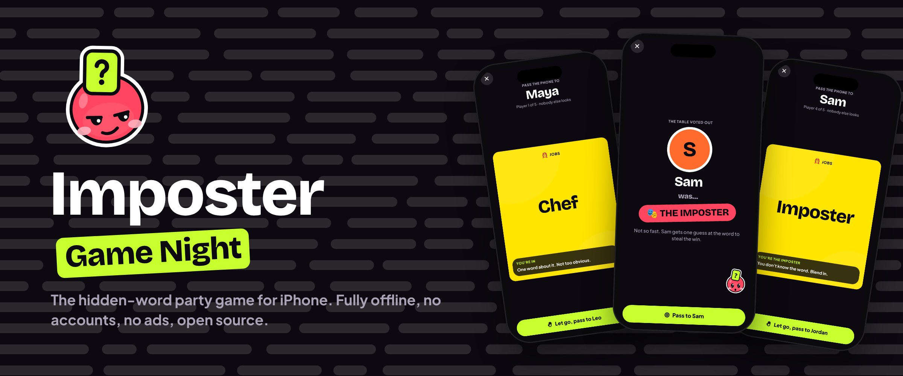
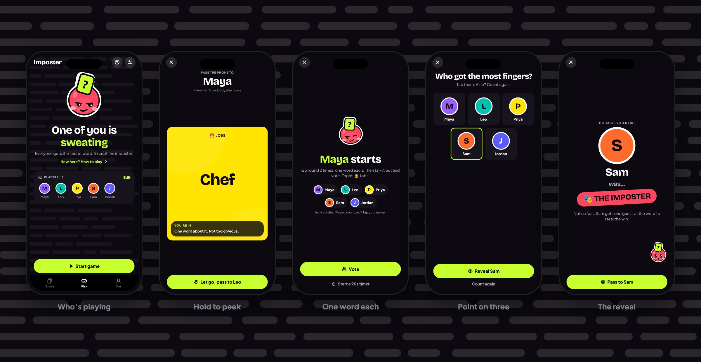
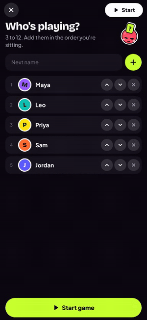
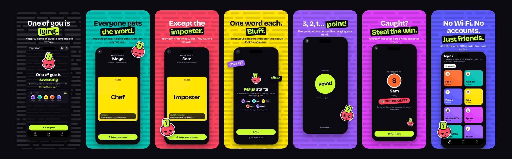
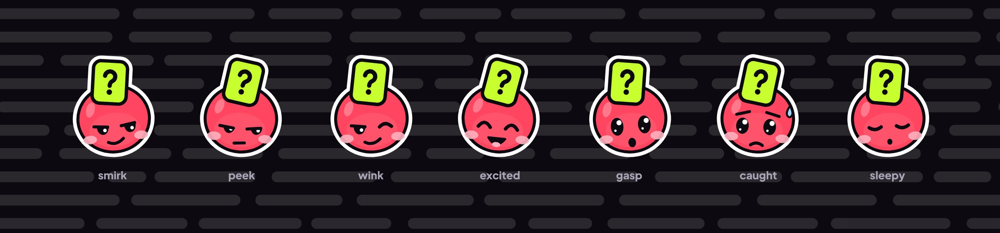
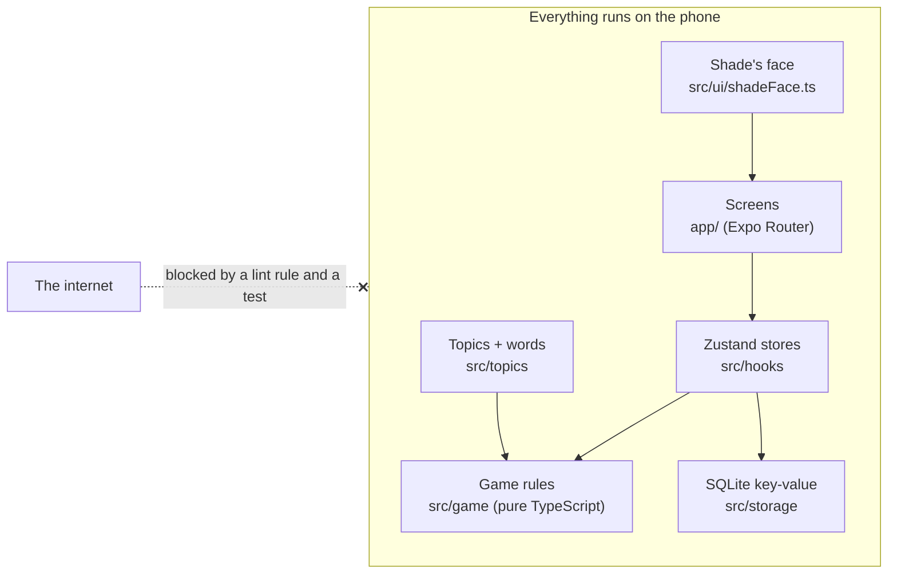
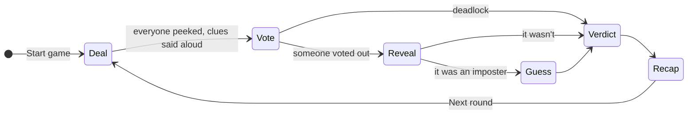

<p align="center">
  
</p>

<p align="center">
  <a href="https://bywilliaml.com/imposter"><b>Website</b></a> ·
  <a href="https://bywilliaml.com/imposter/privacy">Privacy</a> ·
  <a href="./SPEC.md">Spec</a> ·
  <a href="./DEPLOY.md">Ship it yourself</a> ·
  <a href="#fork-it">Fork it</a>
</p>

<p align="center">
  
  
  
  
  
  
  
</p>

# Imposter: Game Night

**One of you is lying. Find them.** Everyone at the table gets the same secret
word, except the imposter. Pass one phone round, give one-word clues, argue, and
point on three. Catch the imposter and they still get one guess at the word to
steal the win.

It's the party game you already play with a friend reading words off their
phone, rebuilt so that the phone runs the game: it deals, keeps the secret,
counts you in, and never makes anyone sit out to be the host.

<p align="center">
  
</p>

## Why I built it

I'd built [Charades](https://github.com/byw1/charades) and wanted a second
game on the same bones: something you could start in two taps at a dinner
table, a campsite or a basement with no signal. The rules I set:

- **Two taps to play.** Type names once. After that it's one button.
- **The phone never gives the imposter away.** Every card looks, sounds and
  buzzes the same, in or imposter.
- **No internet, ever.** No server, no account, no analytics, no ads.
  Enforced by the build, not by good intentions.
- **Everything free.** 12 topics, 600 words, and your own topics, from install.

## See it in action

<table>
  <tr>
    <td width="36%" align="center">
      <br>
      <sub>A real round, recorded from the app (sped up).</sub>
    </td>
    <td>
      <b>A round, start to finish</b>
      <ol>
        <li><b>Pass and peek.</b> Each name fills the screen. Hold the pill and your card turns over: the word, or <i>Imposter</i>. Let go and it's face down, already showing the next name.</li>
        <li><b>Clues.</b> The phone goes in the middle: <i>“Maya starts.”</i> Go round, one word each. Too obvious helps the imposter; too vague looks suspicious.</li>
        <li><b>Talk.</b> Argue it out. A timer is one tap away if your table likes pressure.</li>
        <li><b>Vote.</b> The phone counts everyone in, 3-2-1, <i>Point!</i> Tap whoever got the most fingers. Or play a secret vote, counted out one dot at a time.</li>
        <li><b>Reveal.</b> Drumroll, Shade trembles, the censor bar slides off: <i>in</i>, or <i>the imposter</i>.</li>
        <li><b>The steal.</b> A caught imposter picks the word from eight in the same topic. Right, and they steal the win.</li>
        <li><b>Verdict.</b> Blue for <i>Caught!</i>, Shade's red for <i>Got away</i> or <i>Stole it</i>. Then the word, the points, and tonight's table.</li>
      </ol>
    </td>
  </tr>
</table>

<p align="center">
  
</p>

## Features

**🎭 Play**
- 3 to 12 players. 1 to 3 imposters (it scales with the table), or a surprise.
- **Hint on or off**: imposters see the topic, or play fully blind.
- One, two or three laps of clues. An optional talk timer.
- **Point vote** (loud, fast) or **secret vote** (never for yourself; ties revote; a tied revote lets the imposters slip away).
- Scores across rounds, and a recap of who scored what.

**📚 Topics**
- 12 topics, 50 words each: Food, Animals, Places, Jobs, Movies & TV, Sports, Around the House, Music, Party, Fantasy, School, Travel.
- Pick some, or mix them all. Nobody sees a word twice in one night until every word is used.
- **Make your own**: inside jokes, your town, your group chat. Paste a list from anywhere.

**🛟 Never lose a game**
- The game saves at every step. Close the app mid-vote, or let the phone die, and it opens on the same screen.
- Missed your card? Tap your name on the clue sheet for another look.

**🎨 Feel**
- **Shade**, the mascot: a red sticker head with shifty, half-shut eyes and a question mark stuck to its forehead. It blinks, glances round the table and reacts when you poke it.
- Sound effects, haptics, Dynamic Type, reduced motion, and layouts checked at large text sizes.

<p align="center">
  
</p>

## How it's built

| | |
| --- | --- |
| **App** | Expo SDK 57, React Native 0.86, React 19, Expo Router (typed routes) |
| **Language** | TypeScript, strict |
| **State** | Zustand stores, persisted to `expo-sqlite`'s key-value store |
| **Graphics** | `react-native-svg` for Shade; the stock `Animated` API for everything that moves |
| **Sound** | `expo-audio`: effects generated by a script (`spec/generate-sounds.js`) |
| **Tests** | Jest, in two projects: pure logic (`ts-jest`) and app code (`jest-expo`) |
| **Builds** | EAS Build and Submit; the App Store listing lives in [`store.config.json`](./store.config.json) |



A round is a small state machine. Each phase is one screen, and the phase plus
its progress is saved after every step:



### Engineering highlights

**1. A deal that can't leak.** The hardest rule in a hidden-role game is that
nobody can tell the roles apart from across the table. The in card and the
imposter card share one colour, one layout, one reveal animation, one sound and
one haptic. The card only shows while a thumb is on the button, and on release
it hides *before* any animation runs, so a role is never left on screen. A tap
is never enough: the button fills over a hold, so a brush of the hand or a
curious neighbour can't flip it.

**2. “Offline” enforced by the build.** An ESLint rule bans `fetch`,
`XMLHttpRequest`, `WebSocket` and `EventSource`. A test
([`src/noNetwork.test.ts`](./src/noNetwork.test.ts)) scans the source for the
same things, so the rule can't be switched off with a disable comment.

**3. Pure game logic.** Dealing, voting, scoring, word picking and history live
in [`src/game`](./src/game) as plain TypeScript. A lint rule stops React, React
Native or Expo from being imported there, so every rule is unit-tested without
rendering a screen, and randomness is injected so tests are deterministic.

**4. Resume anywhere.** The session, the phase and its progress (whose turn to
peek, who has voted) are saved at every step and validated on load. Kill the
app mid-vote and it reopens on the same screen. Saved games from older versions
are migrated rather than thrown away.

**5. One mascot, two renderers.** Shade's face is data:
[`src/ui/shadeFace.ts`](./src/ui/shadeFace.ts) describes every mood as SVG
shapes. The app draws them with `react-native-svg`, and
[`spec/generate-mascot.js`](./spec/generate-mascot.js) writes the same shapes
out as static SVGs for the website and store art, so the two can't drift.

**6. Store art generated from the real app.**
[`scripts/store-art`](./scripts/store-art) builds the web version of the app,
plays a real five-player game in Chromium, and captures every screen. It then
composes the App Store screenshots, two social videos (drawn frame by frame
from a pure `render(t)` function and encoded with ffmpeg) and every picture in
this README. Change the app, run `npm run store-art`, and the marketing is up
to date.

## Run it

You need Node 22+ and an iPhone with [Expo Go](https://expo.dev/go).

```sh
npm install
npm start          # scan the QR code with your iPhone's camera
```

Checks:

```sh
npm run typecheck  # tsc --noEmit
npm run lint       # eslint, including the no-network and pure-logic rules
npm test           # jest
```

To install it as a real app, or ship it:

```sh
npm run phone      # an installable build for your own iPhone
npm run store      # build and upload to TestFlight / App Store Connect
npm run store-art  # regenerate screenshots, videos and README images
```

[DEPLOY.md](./DEPLOY.md) walks through every step, including what Apple needs.

## Fork it

I'd love for this to be a starting point. A version for your language, your
classroom, your favourite show, or a new party game on the same bones? Fork it.

1. **Rename it.** The code is yours under AGPL-3.0. The name, Shade, the icon
   and the artwork are not ([TRADEMARK.md](./TRADEMARK.md)). Change `name`,
   `slug`, `scheme` and `ios.bundleIdentifier` in `app.json`.
2. **Swap the words.** Every topic is an entry in
   [`src/topics/bundled.ts`](./src/topics/bundled.ts): a name, an emoji, a
   colour and 50 words.
3. **Re-skin it.** Colours, type and spacing live in
   [`src/ui/tokens.ts`](./src/ui/tokens.ts). Draw your own mascot in
   [`src/ui/shadeFace.ts`](./src/ui/shadeFace.ts).
4. **Change the rules.** Dealing, votes and scoring are pure functions in
   [`src/game`](./src/game), with tests to tell you what you broke.

Good places to read first: [`src/game/deal.ts`](./src/game/deal.ts),
[`src/game/vote.ts`](./src/game/vote.ts),
[`src/hooks/useGame.ts`](./src/hooks/useGame.ts) and [SPEC.md](./SPEC.md).

## Project layout

```
app/                Screens (Expo Router)
  round/            deal (peek, then clues) → vote → reveal → guess → verdict → recap
  new/              Who's playing, house rules
  topics/           A topic's words; the topic editor
src/
  game/             Pure game logic: no React, no React Native
  topics/           The 12 bundled topics; parsing pasted lists
  hooks/            Zustand stores: the game, the table, history, settings
  storage/          The key-value store
  round/            Shared round chrome
  home/             The three swipeable home pages: Topics, Play, You
  ui/               Components, design tokens, Shade
  media/            Sound effects
spec/               Generators for Shade's SVGs and the sound effects
scripts/store-art/  Screenshots, videos and README images from the real app
docs/images/        The pictures in this README
```

## Docs

- [SPEC.md](./SPEC.md): the product spec and the rules of the game.
- [DEPLOY.md](./DEPLOY.md): from this repo to your iPhone, or the App Store.
- [PRIVACY.md](./PRIVACY.md): what the app stores (all of it on your phone) and what it doesn't.
- [store.config.json](./store.config.json): the App Store listing, as code.

## Made by

**William**: [bywilliaml.com](https://bywilliaml.com) · [the Imposter page](https://bywilliaml.com/imposter) · [Charades](https://github.com/byw1/charades), its sibling.

If you build something from this, I'd genuinely like to see it.

## Licence

Code: [AGPL-3.0](./LICENSE). See [NOTICE](./NOTICE) for dual licensing. The
name, Shade, the icon, the screenshots and the artwork in `docs/images` are not
covered by the code licence ([TRADEMARK.md](./TRADEMARK.md)). Forks must rename.
